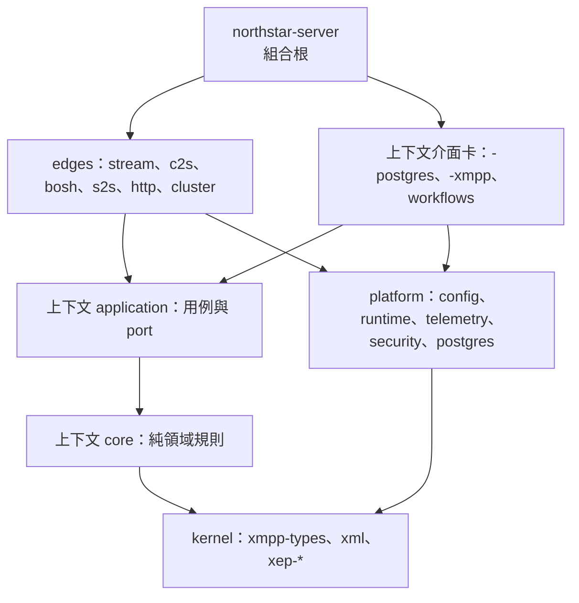

# Northstar 目標架構與全面重構計劃

本文是 S16 起全面重構的權威藍圖：定義理想的 workspace 架構、各層與各上下文的邊界規則，以及從現況遷移過去的
階段順序。S0–S15 的紀錄、委派協議與驗收方式仍以[工程結構藍圖](engineering-structure.zh-TW.md)為準；
本文完成的階段同樣記錄在該文的 §5 與 §8。

## 1. 結論

Northstar 的部署形態維持現狀：一個二進位檔，以 core、maintenance 或 standalone 角色執行，共用 PostgreSQL
（見 [SUBSERVERS.md](../SUBSERVERS.md)）。改變的是原始碼的組織方式：

- **根 crate 解體**：現在的 `rust-xmpp-server`（`src/`，約 39.7 萬行）依限界上下文拆成多個 crate，最後只剩一個
  很薄的組合根 `northstar-server`。
- **邊界交給編譯器**：重要的邊界必須是 crate 邊界，由 Cargo 依賴圖與可見性強制執行。以正則比對原始碼的門禁
  逐步退役，只保留型別系統表達不了的語義檢查，而且優先改寫成測試。
- **`AppState` 消失**：各上下文自己擁有服務與執行期狀態，組合根把它們接起來；不再有傳遍全系統的服務定位器。
- **會話核心與傳輸無關**：傳輸層只搬移位元組與 frame；串流協商與 stanza 分派在會話核心中完成；協定處理器只拿到
  窄的會話介面。

## 2. 現況診斷（`ff7f95c`）

| 問題 | 數據 |
| --- | --- |
| 邏輯集中在根 crate | `src/` 約 39.7 萬行：`db` 13.1 萬、`xmpp` 8.8 萬、`services` 5.9 萬、`state` 1.8 萬、`s2s` 1.6 萬、`cluster` 1.6 萬、`api` 1.3 萬、`stage4_replay` 1.1 萬、`bosh` 1.1 萬。60 個 workspace crate 合計 8.3 萬行，其中 core／application crate 多數不到 3 千行 |
| 組合根是服務定位器 | `AppState` 有 97 個欄位，包括約 40 個服務實例、即時路由表、快取、連線計數與設定；約 510 個方法分散在 96 個檔案；`xmpp` 用到其中 156 個。S15 後的 22 條分層基線另有 37 個檔案經 `use super::*;` 間接依賴它 |
| 會話物件過寬 | `ProtocolSession` 有 50 個欄位，TCP、TLS、WebSocket、BOSH 都直接操作它 |
| 協定處理器依賴傳輸 | `xmpp/protocol/messaging` 直接引用 `bosh` 與 `s2s` |
| 應用服務彼此纏繞 | `services` 內有循環：`sm`↔`authentication`、`profile`↔`pubsub`、`xml_util`↔`muc`；`xml_util`（2.7 千行）同時引用 `muc`、`abuse`、`jingle`、`stanza_validation`；`messaging`、`federation_outbox` 反向引用介面卡層 |
| 持久化按資料表而非上下文組織 | `db` 13.1 萬行（含測試）；SQL 全為執行期查詢（約 3,540 處 `sqlx::query*(`，無編譯期巨集），可以隨上下文搬動 |
| 邊界靠字面比對 | 36 支 check 腳本，`check-architecture-boundaries.mjs` 單檔 4,117 行，16 支直接讀 `src/` 路徑；每次結構調整都要修改門禁 |
| 行數預算被湊數 | 大量檔案落在 1,400–1,500 行；3 個超標檔與其 fixtures 被 Stage 4 證據以雜湊釘住 |
| 原型程式碼混在 workspace | `services/*` 的 15 個微服務原型（README 註明未整合、不可上線），以及只被它們使用的 `foundation-*` crate |

## 3. 設計原則

1. **邊界由編譯器執行。** 任何需要守住的依賴方向都要落在 crate 邊界上；檢查依賴圖的門禁只讀 `cargo metadata`，
   不讀原始碼文字。
2. **依限界上下文垂直切分。** 每個上下文擁有自己的領域規則、用例、持久化與協定映射；不再有橫跨全系統的
   `services`、`db` 桶子。
3. **依賴反轉，消費者擁有 port。** 應用層宣告它需要的 port（repository、通知、時鐘、其他上下文的查詢），介面卡
   實作，組合根綁定。跨上下文呼叫由呼叫方定義 port，提供方不被依賴，所以不會產生應用層循環。上下文之間只共享
   `-core` 中的值型別。
4. **唯一的組合根。** 只有 `northstar-server` 知道所有具體型別。
5. **會話核心與傳輸無關。** 協定處理器不得依賴任何傳輸 crate。
6. **行為不變、持續全綠。** 每個 WP 都保持 CI 綠燈；SQL、鎖、交易、wire 格式、錯誤訊息與門禁強度不變；
   測試依路徑對應後一一保留。語義上的改進（例如模組化計劃的 C1、C2）在新結構中另外進行。
7. **交易邊界原樣保留。** 持久化介面卡擁有交易；跨上下文、必須在同一交易內完成的流程放在明確的 workflow
   介面卡中並列入清單，不藏在協定程式碼裡。

## 4. 目標結構

### 4.1 層級

| 層 | crate | 可以依賴 | 不可以依賴 |
| --- | --- | --- | --- |
| kernel | `northstar-xmpp-types`、`northstar-xml-builder`、`northstar-xml-framing`、`northstar-xep-core`、`northstar-xep-*`、`northstar-xep-catalog`（內建 XEP 的組裝與啟用） | kernel | 其他所有層；非同步執行期、SQL、網路 |
| platform | `northstar-config`、`northstar-runtime`（worker 與監督、關機、連線 actor）、`northstar-telemetry`、`northstar-security`（TLS 素材、DANE、位址範圍、金鑰）、`northstar-postgres`（連線池、migration、交易輔助、outbox 原語、測試夾具） | kernel、platform | 任何上下文 |
| context core | `northstar-<ctx>-core` | kernel、其他上下文的 core（無循環） | 非同步執行期、SQL、網路、platform 的 IO 實作 |
| context application | `northstar-<ctx>-application` | 本上下文 core、kernel、其他上下文的 core、platform 的契約型別 | sqlx、axum、tokio 網路、任何介面卡與 edge |
| context adapter | `northstar-<ctx>-postgres`、`northstar-<ctx>-xmpp`（必要時 `-http`；物件儲存為 `-storage`）、`northstar-workflows` | 本上下文 application 與 core、platform、kernel；`-xmpp` 另可依賴 `northstar-stream` | 其他上下文的介面卡；`-xmpp` 不可依賴 `-postgres` 與任何傳輸 |
| edge | `northstar-stream`（會話核心）、`northstar-c2s`、`northstar-bosh`、`northstar-s2s`、`northstar-http`、`northstar-cluster` | application、core、platform、kernel；`stream` 以外的 edge 可依賴 `northstar-stream` | 上下文的 `-postgres` |
| composition | `northstar-server`（bin） | 全部 | — |
| tooling | `tools/*`、測試支援 crate | 全部 | 不得成為執行期依賴 |

### 4.2 限界上下文

上下文名稱沿用既有 crate 的前綴。來源欄列出目前的主要位置；`state` 中屬於該上下文的執行期狀態與 accessor
一併移入。資料表歸屬以 `catalog/data-ownership.yaml` 為起點，在各上下文的階段中逐表確認。

| 上下文 | 職責 | 主要來源 |
| --- | --- | --- |
| `auth` | 帳號、SASL／SASL2／FAST、passkey、legacy auth、帳號註冊、密碼變更、登入挑戰 | `services/{authentication,account,account_admin,passkeys,password_change,http_login,challenge_issuance}`、`db/{users,account_repository,authentication,session_identity,jid_identity,fast}`、`xmpp/protocol/{sasl2,legacy_auth,ibr}`、`xmpp/auth_publication`；既有 `auth-core` |
| `session` | 即時會話、資源綁定、本節點路由表、SM、CSI、實體能力（caps）、會話清理、容量 | `xmpp/local_routes`、`state/{local_session,session_cleanup*}`、`services/{sm,sm_teardown,sm_capacity}`、`db/{sm,sm_repository}`、`xmpp/protocol/{sm,sm_owner,session_sm,session_transport,csi,caps}`；既有 `session-core`、`session-application`、`protocol-runtime` |
| `roster` | 名冊、出席訂閱與廣播、隱私清單、封鎖 | `services/{presence,privacy,blocking}`、`db/{roster,privacy}`、`xmpp/protocol/{roster,presence,privacy,blocking}`；既有 `roster-core`、`roster-application`、`presence-core` |
| `message` | 一對一訊息准入與遞送、Carbons、回執、離線佇列、撤回、Jingle 轉送、推播 | `services/{messaging,message_admission,message_carbons,retractions,jingle,direct_spool_wake}`、`db/{messaging,retractions,push}`、`xmpp/protocol/{messaging,retractions}`、`xmpp/{direct_delivery,outbound}`；既有 `message-core`、`message-application`、`delivery-core` |
| `archive` | 個人 MAM 與其偏好 | `services/mam`、`db/archive`、`xmpp/protocol/mam`；既有 `archive-core`、`archive-application` |
| `room` | MUC、聯邦 MUC、MIX、MIX／MUC 鏡像、房間 MAM 視圖、鎖定房間到期 | `services/{muc,mix}`、`db/{muc,room,cluster_muc,mix,mix_repository,mix_identity}`、`xmpp/protocol/{muc,federated_muc,mix,mix_muc}`；既有 `room-core`、`room-application`。協定介面卡分為 `northstar-muc-xmpp` 與 `northstar-mix-xmpp` |
| `pubsub` | PubSub、PEP、個人檔案與 vCard、私有儲存 | `services/{pubsub,profile,private_storage}`、`db/{pubsub,pubsub_repository,pep,pubsub_outbox,profile,vcard,private}`、`xmpp/protocol/{pubsub,pep,vcard,private}`；既有 `pubsub-core`、`pubsub-application` |
| `upload` | HTTP 上傳槽、物件儲存、對帳與遷移 | `services/upload*`、`db/upload*`、`xmpp/protocol/upload`、`api/upload`、`storage`、`runtime/upload_worker`；既有 `upload-core`、`upload-application` |
| `federation` | S2S 政策、聯邦 outbox、dialback 金鑰、端點探索、元件憑證 | `services/federation_outbox`、`db/s2s`、`s2s` 中非連線的部分；既有 `federation-core`、`federation-application` |
| `abuse` | 濫用政策、速率與風險、濫用金鑰 | `services/{abuse,login_abuse}`、`db/{abuse_keys,abuse_persistence_repository}`；既有 `abuse-policy` |
| `operations` | 管理命令、報告與審核、資料生命週期、保存政策與保存期限清理、治理、操作日誌、指標與就緒狀態 | `services/{admin_*,reports,report_moderation,retention_policy,operations,api_queries,api_mutations,readiness,metrics_snapshot}`、`db/{admin_commands,reports,data_lifecycle,retention,api_operations,api_control,capacity,role_attestation}`、`runtime/retention`、`xmpp/protocol/commands` |

`services/xml_util` 依內容拆回各上下文；只剩純 XML 工具的部分併入 kernel。

### 4.3 會話核心與傳輸

- `northstar-stream` 是會話核心：串流協商狀態機（既有的 `StreamNegotiation`）、驗證與綁定的流程控制（透過
  `auth`、`session` 的 port），以及 stanza 分派註冊表。
- 每個上下文的 `-xmpp` crate 實作 `StanzaHandler`，由組合根註冊。處理器只拿到窄的 `SessionContext`：已綁定的
  JID、串流功能、有序的 outbound sink（既有的 `OrderedOutboundSink`）、SM 與 CSI 狀態。`ProtocolSession`
  的 50 個欄位拆回會話核心與各上下文。
- `northstar-c2s`（TCP、STARTTLS、direct TLS、WebSocket）、`northstar-bosh`、`northstar-s2s` 只負責連線、
  frame 與背壓，再把 frame 交給 `northstar-stream`。
- `northstar-http` 以 axum 提供 REST、管理 API、上傳端點與 web surface，呼叫各上下文的 application。
- `northstar-cluster` 是跨節點的介面卡：實作 `session` 的遠端路由 port、`room` 的佔用投影 port 等，並執行
  叢集監聽與復原重播。
- 協定處理器需要「送到某個 JID」時，一律經過 `session` 的路由 port；不再直接觸碰 BOSH 或 S2S（修正現在
  `messaging` 對 `bosh`、`s2s` 的依賴）。

### 4.4 組合根

`northstar-server`：載入設定，建構 platform（連線池、遙測、TLS 素材），建構各上下文模組，把跨上下文的
port 綁定到提供方，註冊 stanza 處理器，再依程序角色（core、maintenance、standalone）啟動 edge 與 worker，
並監督關機。即時狀態（路由表、MUC 佔用者、caps 快取、連線計數）歸屬於擁有它的上下文；`tools/` 的子命令留在
二進位檔中，呼叫各上下文的 application。

### 4.5 持久化

- 單一 schema 與 `migrations/` 目錄保持不變，由 `northstar-postgres` 執行。
- 每個上下文的 `-postgres` crate 只寫自己資料表的 SQL，實作自己的 port。例外是 `users`：上下文介面卡可以讀取與鎖定（確認帳號仍啟用、固定授權世代），寫入屬於 `auth`，測試 fixture 可以插入。
- 必須在同一交易中跨上下文完成的流程（例如帳號刪除與拆除、MUC／MIX 鏡像連結），
  放在 `northstar-workflows`：它取得一個交易，依序呼叫各上下文 `-postgres` 的 `*_in(&mut tx)` 函式（現有程式
  已普遍使用這個形式），鎖順序與原本相同。已知的例子是 MUC／MIX 鏡像連結：`link_mix_muc_by_localpart` 在同一
  交易中確認同一擁有者後寫入兩邊的資料表。S20 與 S21 確認的例子還有：`PostgresMamRepository`（封存、房間政策與 S2S outbox），以及 `PostgresPubSubRepository`、`db/profile.rs`、`db/pep_roster.rs`（在 pubsub 交易中讀取名冊與隱私資料表）。S22 確認的例子：`RosterTransactionEffects`（名冊交易中取消 PEP 訂閱、寫入 S2S outbox、讀取 MIX 參與者），根 crate 的 `RootRosterEffects` 是它的暫時實作。完整清單在各上下文的階段中逐一確認，記錄在本節。

### 4.6 測試

- 單元測試隨程式碼移動。PostgreSQL 整合測試移到對應的 `-postgres` crate。端到端協定測試移到
  `northstar-server/tests`。
- Stage 4 重播與 saved-case 夾具是只在測試編譯的程式碼，移到專用的測試支援 crate。依 2026-10-22 的決定，
  `catalog/source-structure-baseline.json` 的 `pinned` 解除；已保存的 Stage 4 證據仍綁定其原提交，之後若要產生
  新的 Stage 4 record，需重新產生來源契約。
- 測試延續檢查改為整個 workspace：`cargo test --workspace -- --list` 的名稱集合，經「舊路徑 → crate 與新路徑」
  的對應後必須與基準相同。

### 4.7 門禁

- 新的 crate 依賴圖門禁讀 `cargo metadata` 與 `catalog/crates.yaml` 的層級，拒絕違反 4.1 的依賴，並依層級限制
  外部依賴（例如 application 層不得依賴 `sqlx`、`axum`、`hickory-resolver`、`tokio-rustls`）。
- `catalog/source-layers.json`（R9）在 `src/` 消失時退役。
- 讀原始碼文字的門禁逐支處理：邊界已由 crate 圖保證的直接刪除（例如「協定模組不得使用 `db::`」）；交易順序、
  outbox 等語義檢查改寫成擁有該行為的 crate 中的測試；在那之前，每個 WP 都列出它要更新的門禁。

## 5. 遷移順序

採用 strangler 方式：新結構與舊結構並存，一次搬一個完整的垂直切片，根 crate 逐步縮小，最後只剩組合根並更名為
`northstar-server`。順序依 §2 的相依圖決定：先處理沒有上游依賴的平台，再建立讓處理器能離開根 crate 的會話核心
介面，接著由葉到樞紐搬上下文。

| 階段 | 內容 | 退出條件 |
| --- | --- | --- |
| S16 地基 | 刪除 `services/*` 原型與只被它們使用的 crate、工具與 CI 步驟（逐項列表確認）；既有 crate 依 4.1 移入 `crates/{kernel,platform,contexts,edges}` 目錄（套件名稱不變）；建立 crate 依賴圖門禁與層級目錄；解除 Stage 4 釘選；記錄建置時間基準 | workspace 全綠；crate 圖門禁通過；根 crate 行數不變。已完成（WP-160–165，見[工程結構藍圖](engineering-structure.zh-TW.md) 5.12） |
| S17 平台 | `src/platform`、`src/security`、`jid`、`auth` facade 移為 platform 與 kernel crate；`src/storage` 只服務上傳，隨 S19 移入 upload 上下文 | 根 crate 不再含平台程式碼。已完成（WP-171–178，見[工程結構藍圖](engineering-structure.zh-TW.md) 5.13） |
| S18 會話核心介面 | 建立 `northstar-stream`：`StanzaHandler`、`SessionContext`、分派註冊表；根 crate 的分派改經註冊表，處理器暫時以轉接器包住；以 `session` 路由 port 切斷協定處理器對 `bosh`、`s2s` 的依賴 | 分派只經註冊表；協定處理器不再引用傳輸模組。已完成（WP-181–185，見[工程結構藍圖](engineering-structure.zh-TW.md) 5.14）：IQ 只經路由表分派；會話能力由各上下文的 `-xmpp` crate 以窄 trait 定義，`StanzaHandler` 留到 S30 |
| S19–S28 上下文 | 依序搬移：`upload` → `archive` → `pubsub` → `roster` → `abuse` → `auth` → `operations` → `room` → `message` → `federation`。每個上下文：先定義 port 與模組結構、以它取代對應的 `AppState` accessor，再把 `services`、`db`、`xmpp/protocol` 中的程式碼移入各 crate，最後更新門禁並在組合根綁定。`api` 的端點依 4.3 屬於 `northstar-http`，於 S30 移出；端點使用的應用層型別隨上下文移動 | 該上下文的應用、持久化與協定程式碼不再出現在根 crate；`AppState` 只持有組合根建構的上下文模組。S19 upload 已完成（WP-191–203，見[工程結構藍圖](engineering-structure.zh-TW.md) 5.15）；S20 archive 已完成（WP-210–214，見 5.16）；S21 pubsub 已完成（WP-220–231，見 5.17）；S22 roster 已完成（WP-240–248，見 5.18） |
| S29 會話與叢集 | `session` 上下文與 `northstar-cluster` | 路由表、SM、叢集監聽離開根 crate |
| S30 傳輸 | `northstar-c2s`、`northstar-bosh`、`northstar-s2s`、`northstar-http`；`ProtocolSession` 拆解完畢 | 根 crate 只剩組合程式碼 |
| S31 組合根 | 根 crate 更名為 `northstar-server`，`AppState` 刪除；R9 與其餘讀原始碼的邊界門禁退役；文件改寫 | `src/` 只有組合根；全部門禁與完整 CI 通過 |

與其他計劃的關係：模組化執行計劃的 C1（PubSub）與 C2（MAM）是語義上的重構，在對應上下文搬進新 crate 後於新
結構中進行；D1 由 S18 與 S30 吸收；R1–R3 不受影響。

## 6. 執行與驗收

沿用[工程結構藍圖](engineering-structure.zh-TW.md) §6 的協議：架構負責人撰寫規格、以腳本完成機械搬移並先提交、
依序執行 cargo；agy 只補匯入、可見性、port 接線與門禁；每個 WP 在獨立 worktree 中進行。每個階段的退出檢查：

- `cargo fmt --check`、`cargo clippy --workspace --all-targets --all-features --locked -- -D warnings`；
- 測試名稱依對應後與基準相同，`cargo test --workspace --all-targets --all-features --locked` 全部通過；
- crate 依賴圖門禁與其餘門禁通過；離線 CI 全部通過；
- 推送 dev 後 GitHub CI 全綠；根 crate 行數只減不增。

## 7. 風險與對策

| 風險 | 對策 |
| --- | --- |
| 搬移時改到交易或鎖順序 | SQL 與交易邊界逐字搬移；跨上下文交易集中在 `northstar-workflows` 並列入清單；保留既有並行與鎖順序測試 |
| 上下文之間出現循環 | 消費者擁有 port，上下文之間只共享 core 值型別；Cargo 本身拒絕 crate 循環 |
| 建置時間 | S16 記錄基準（[工程結構藍圖](engineering-structure.zh-TW.md) 5.12）；拆分後可平行與增量編譯，預期改善；每個階段比較一次 |
| 門禁大量修改 | 每個 WP 列出受影響門禁；邊界一旦由 crate 圖保證就刪除對應的字面檢查 |
| 文件與證據路徑失效 | 現行文件隨階段更新；`docs/evidence`、`docs/handoff`、`recovery` 是歷史紀錄，不改寫 |
| 規模過大、階段拖長 | 每個階段都可獨立上線；任何時點中止，系統都是全綠且結構比前一階段清楚 |
