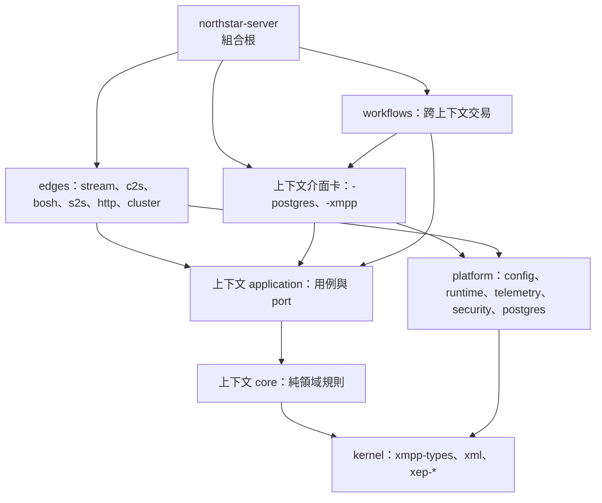

# Northstar 目標架構與全面重構計劃

本文是 S16 起全面重構的權威藍圖：定義理想的 workspace 架構、各層與各上下文的邊界規則，以及從現況遷移過去的
階段順序。S0–S15 的紀錄、委派協議與驗收方式仍以[工程結構藍圖](engineering-structure.zh-TW.md)為準；
本文完成的階段同樣記錄在該文的 §5 與 §8。

## 1. 結論

Northstar 的部署形態維持現狀：一個二進位檔，以 core、maintenance 或 standalone 角色執行，共用 PostgreSQL
（見 [SUBSERVERS.md](../SUBSERVERS.md)）。改變的是原始碼的組織方式：

- **根 crate 解體**：S16 時的 `rust-xmpp-server`（`src/`，約 39.7 萬行）依限界上下文拆成多個 crate，最後只剩一個
  很薄的組合根 `northstar-server`。S31 完成：生產碼約 1.6 萬行，其餘是測試。
- **邊界交給編譯器**：重要的邊界必須是 crate 邊界，由 Cargo 依賴圖與可見性強制執行。以正則比對原始碼的門禁
  逐步退役，只保留型別系統表達不了的語義檢查，而且優先改寫成測試。
- **`AppState` 消失**：各上下文自己擁有服務與執行期狀態，組合根把它們接起來；不再有傳遍全系統的服務定位器。
- **會話核心與傳輸無關**：傳輸層只搬移位元組與 frame；串流協商與 stanza 分派在會話核心中完成；協定處理器只拿到
  窄的會話介面。

## 2. 現況診斷（`ff7f95c`）

| 問題 | 數據 |
| --- | --- |
| 邏輯集中在根 crate | `src/` 約 39.7 萬行：`db` 13.1 萬、`xmpp` 8.8 萬、`services` 5.9 萬、`state` 1.8 萬、`s2s` 1.6 萬、`cluster` 1.6 萬、`api` 1.3 萬、`stage4_replay` 1.1 萬、`bosh` 1.1 萬。60 個 workspace crate 合計 8.3 萬行，其中 core／application crate 多數不到 3 千行 |
| 組合根是服務定位器 | `AppState` 有 97 個欄位，包括約 40 個服務實例、即時路由表、快取、連線計數與設定；約 510 個方法分散在 96 個檔案；`xmpp` 用到其中 156 個。S15 後的 22 條分層基線另有 37 個檔案經 `use super::*;` 間接依賴它 |
| 會話物件過寬 | `ProtocolSession` 有 50 個欄位，TCP、TLS、WebSocket、BOSH 都直接操作它 |
| 協定處理器依賴傳輸 | `xmpp/protocol/messaging` 直接引用 `bosh` 與 `s2s` |
| 應用服務彼此纏繞 | `services` 內有循環：`sm`↔`authentication`、`profile`↔`pubsub`、`xml_util`↔`muc`；`xml_util`（2.7 千行）同時引用 `muc`、`abuse`、`jingle`、`stanza_validation`；`messaging`、`federation_outbox` 反向引用介面卡層 |
| 持久化按資料表而非上下文組織 | `db` 13.1 萬行（含測試）；SQL 全為執行期查詢（約 3,540 處 `sqlx::query*(`，無編譯期巨集），可以隨上下文搬動 |
| 邊界靠字面比對 | 36 支 check 腳本，`check-architecture-boundaries.mjs` 單檔 4,117 行，16 支直接讀 `src/` 路徑；每次結構調整都要修改門禁 |
| 行數預算被湊數 | 大量檔案落在 1,400–1,500 行；3 個超標檔與其 fixtures 被 Stage 4 證據以雜湊釘住 |
| 原型程式碼混在 workspace | `services/*` 的 15 個微服務原型（README 註明未整合、不可上線），以及只被它們使用的 `foundation-*` crate |

## 3. 設計原則

1. **邊界由編譯器執行。** 任何需要守住的依賴方向都要落在 crate 邊界上；檢查依賴圖的門禁只讀 `cargo metadata`，
   不讀原始碼文字。
2. **依限界上下文垂直切分。** 每個上下文擁有自己的領域規則、用例、持久化與協定映射；不再有橫跨全系統的
   `services`、`db` 桶子。
3. **依賴反轉，消費者擁有 port。** 應用層宣告它需要的 port（repository、通知、時鐘、其他上下文的查詢），介面卡
   實作，組合根綁定。跨上下文呼叫由呼叫方定義 port，提供方不被依賴，所以不會產生應用層循環。上下文之間只共享
   `-core` 中的值型別。
4. **唯一的組合根。** 只有 `northstar-server` 知道所有具體型別。
5. **會話核心與傳輸無關。** 協定處理器不得依賴任何傳輸 crate。
6. **行為不變、持續全綠。** 每個 WP 都保持 CI 綠燈；SQL、鎖、交易、wire 格式、錯誤訊息與門禁強度不變；
   測試依路徑對應後一一保留。語義上的改進（例如模組化計劃的 C1、C2）在新結構中另外進行。
7. **交易邊界原樣保留。** 持久化介面卡擁有交易；跨上下文、必須在同一交易內完成的流程放在明確的 workflow
   介面卡中並列入清單，不藏在協定程式碼裡。

## 4. 目標結構

### 4.1 層級

| 層 | crate | 可以依賴 | 不可以依賴 |
| --- | --- | --- | --- |
| kernel | `northstar-xmpp-types`、`northstar-xml-builder`、`northstar-xml-framing`、`northstar-xep-core`、`northstar-xep-*`、`northstar-xep-catalog`（內建 XEP 的組裝與啟用）、`northstar-time`（chrono 相容的時間戳，曆法用 `time`） | kernel | 其他所有層；非同步執行期、SQL、網路 |
| platform | `northstar-config`、`northstar-runtime`（worker 與監督、關機、連線 actor）、`northstar-telemetry`、`northstar-security`（TLS 素材、DANE、位址範圍、金鑰）、`northstar-postgres`（連線池、migration、交易輔助、outbox 原語、角色證明、測試夾具） | kernel、platform | 任何上下文 |
| context core | `northstar-<ctx>-core` | kernel、其他上下文的 core（無循環） | 非同步執行期、SQL、網路、platform 的 IO 實作 |
| context application | `northstar-<ctx>-application` | 本上下文 core、kernel、其他上下文的 core、platform 的契約型別 | sqlx、axum、tokio 網路、任何介面卡與 edge |
| context adapter | `northstar-<ctx>-postgres`、`northstar-<ctx>-xmpp`（必要時 `-http`；物件儲存為 `-storage`） | 本上下文 application、任何 core、platform、kernel；`-xmpp` 另可依賴 `northstar-stream` | 其他上下文的介面卡；`-xmpp` 不可依賴 `-postgres` 與任何傳輸 |
| workflows | `northstar-workflows` | kernel、platform、任何 core、任何 application、任何 `-postgres` | `-xmpp`、`-http`、edge |
| edge | `northstar-stream`（會話核心）、`northstar-c2s`、`northstar-bosh`、`northstar-s2s`、`northstar-http`、`northstar-cluster` | application、core、platform、kernel；`stream` 以外的 edge 可依賴 `northstar-stream`；`northstar-cluster` 以 Redis pub/sub 作跨節點傳輸，edge 可依賴 redis | 上下文的 `-postgres`、sqlx |
| composition | `northstar-server`（bin） | 全部 | — |
| tooling | `tools/*`、測試支援 crate | 全部 | 不得成為執行期依賴 |

### 4.2 限界上下文

上下文名稱沿用既有 crate 的前綴。來源欄列出目前的主要位置；`state` 中屬於該上下文的執行期狀態與 accessor
一併移入。資料表隨存取它的上下文 `-postgres` crate 搬移，跨上下文且須在同一交易內的存取放在 `northstar-workflows`；
資料庫角色對各資料表的權限以 `deploy/postgres-init/lib/northstar-capability-manifest.sql` 為準。

| 上下文 | 職責 | 主要來源 |
| --- | --- | --- |
| `auth` | 帳號、SASL／SASL2／FAST、passkey、legacy auth、帳號註冊、密碼變更、登入挑戰 | `services/{authentication,account,account_admin,passkeys,password_change,http_login,challenge_issuance}`、`db/{users,account_repository,authentication,session_identity,jid_identity,fast}`、`xmpp/protocol/{sasl2,legacy_auth,ibr}`、`xmpp/auth_publication`；既有 `auth-core` |
| `session` | 即時會話、資源綁定、本節點路由表、SM、CSI、實體能力（caps）、會話清理、容量 | `xmpp/local_routes`、`state/{local_session,session_cleanup*}`、`services/{sm,sm_teardown,sm_capacity}`、`db/{sm,sm_repository,capacity}`、`xmpp/protocol/{sm,sm_owner,session_sm,session_transport,csi,caps}`；既有 `session-core`、`session-application`、`protocol-runtime`。S29 後只碰 session 資料表的 SQL 在 `northstar-session-postgres`，與別的上下文同交易的 SM 儲存在 `northstar-workflows`，transport 與叢集共用的路由表、outbound 與重播在 `northstar-stream` |
| `roster` | 名冊、出席訂閱與廣播、隱私清單、封鎖 | `services/{presence,privacy,blocking}`、`db/{roster,privacy}`、`xmpp/protocol/{roster,presence,privacy,blocking}`；既有 `roster-core`、`roster-application`、`presence-core` |
| `message` | 一對一訊息准入與遞送、Carbons、回執、離線佇列、撤回、Jingle 轉送、外部服務探索、推播 | `services/{messaging,message_admission,message_carbons,retractions,jingle,direct_spool_wake,extdisco}`、`db/{messaging,retractions,push}`、`xmpp/protocol/{messaging,retractions,extdisco}`；既有 `message-core`、`message-application`、`delivery-core`。`xmpp/{direct_delivery,outbound}` 建立在會話與傳輸上，S27 確認歸 session |
| `archive` | 個人 MAM 與其偏好 | `services/mam`、`db/archive`、`xmpp/protocol/mam`；既有 `archive-core`、`archive-application` |
| `room` | MUC、聯邦 MUC、MIX、MIX／MUC 鏡像、房間 MAM 視圖、鎖定房間到期 | `services/{muc,mix}`、`db/{muc,room,cluster_muc,mix,mix_repository,mix_identity}`、`xmpp/protocol/{muc,federated_muc,mix,mix_muc}`；既有 `room-core`、`room-application`。協定介面卡分為 `northstar-muc-xmpp` 與 `northstar-mix-xmpp` |
| `pubsub` | PubSub、PEP、個人檔案與 vCard、私有儲存 | `services/{pubsub,profile,private_storage}`、`db/{pubsub,pubsub_repository,pep,pubsub_outbox,profile,vcard,private}`、`xmpp/protocol/{pubsub,pep,vcard,private}`；既有 `pubsub-core`、`pubsub-application` |
| `upload` | HTTP 上傳槽、物件儲存、對帳與遷移 | `services/upload*`、`db/upload*`、`xmpp/protocol/upload`、`api/upload`、`storage`、`runtime/upload_worker`；既有 `upload-core`、`upload-application` |
| `federation` | S2S 政策、聯邦 outbox、dialback 金鑰、端點探索、元件憑證 | `services/federation_outbox`、`db/s2s`、`s2s` 中非連線的部分；既有 `federation-core`、`federation-application`。`-xmpp` 介面卡邊緣 crate 看不到，所以 `northstar-s2s` 要用的 wire 形式放在 core，命名平台型別的部分放在 application |
| `abuse` | 濫用政策、速率與風險、濫用金鑰 | `services/{abuse,login_abuse}`、`db/{abuse_keys,abuse_persistence_repository}`；既有 `abuse-policy` |
| `operations` | 管理命令、報告與審核、資料生命週期、保存政策與保存期限清理、治理、操作日誌、指標與就緒狀態 | `services/{admin_*,reports,report_moderation,retention_policy,operations,api_queries,api_mutations,readiness,metrics_snapshot}`、`db/{admin_commands,reports,data_lifecycle,retention,api_operations,api_control}`、`runtime/retention`、`xmpp/protocol/commands` |

`services/xml_util` 依內容拆回各上下文；只剩純 XML 工具的部分併入 kernel。

### 4.3 會話核心與傳輸

- `northstar-stream` 是會話核心：`protocol` 模組的 `ProtocolSession<H>` 負責串流協商（SASL、SASL2／FAST、legacy
  auth、IBR、資源綁定）、SM、CSI、caps 與 stanza 分派，對組合根實作的 `SessionHost` 泛型；PostgreSQL repository 是
  `SessionHost` 的關聯型別。S33 起 `SessionHost` 是 13 個關注點 trait 的聚合（身分、帳號、路由、caps、SM、MUC、出席
  政策、訊息效果、MIX ACK、PubSub 效果、分派、生命週期、遙測），以 blanket impl 自動實作；repository 是各關注點的
  關聯型別，只用到 host 參考的函式只約束它需要的關注點。SASL2（含 Bind2、FAST）與 IBR 的線路格式在
  `northstar_stream::wire`；每個會話的出站佇列 `OutboundSender` 屬於 session 上下文
  （`northstar_session_application::outbound`，stream 以原路徑轉出）。
- 每個上下文的 `-xmpp` crate 在 `protocol_session.rs` 為 `ProtocolSession<H>` 實作自己的處理器 trait，`H` 另受該上下文的
  host trait 約束（例如 `PubSubSessionHost`），組合根的 `ServerNode` 實作這些 host trait。核心需要上下文時呼叫取
  `&mut ProtocolSession<Self>` 的 host hook，由組合根以 `-xmpp` 的處理器填入。用戶端 IQ 路由表與服務探索在
  `northstar_stream::protocol::{iq_routes,discovery}`，對 `IqRouteHost` 泛型，組合根綁定各上下文的處理器。S2S 入站節
  同理：處理器在各 `-xmpp` crate 的 `federated_*` 模組，分派與 `<iq/>` 路由在 `northstar_s2s::inbound`，對
  `InboundHost` 泛型。
- `northstar-c2s`（TCP、STARTTLS、direct TLS、WebSocket）、`northstar-bosh`、`northstar-s2s` 只負責連線、
  frame 與背壓，再把 frame 交給 `northstar-stream`。
- `northstar-stream` 的 `test-support` feature 提供 SM 擁有權的記憶體 port 與 fixture
  （`protocol::sm_owner::test_support`），供傳輸 crate 的組合測試使用；傳輸只在 dev-dependency 開啟它。S33 起它也
  提供 `local_routes::session::test_online_session`，讓不能命名 session 應用層的上下文介面卡在測試中建構本機會話。
- `northstar-http` 以 axum 提供 REST、管理 API、上傳端點與 web surface，呼叫各上下文的 application。
- `northstar-cluster` 是跨節點的介面卡：實作 `session` 的遠端路由 port、`room` 的佔用投影 port 等，並執行
  叢集監聽與復原重播。它的 context 對 `ClusterAdapters` 介面卡家族泛型，由組合根綁定 PostgreSQL 這一族；權威資料
  經 session 的 `ClusterSessionStore`、`RecoveryReplayStore` port 到達。
- 協定處理器需要「送到某個 JID」時，一律經過 `session` 的路由 port；不再直接觸碰 BOSH 或 S2S（修正現在
  `messaging` 對 `bosh`、`s2s` 的依賴）。

### 4.4 組合根

`northstar-server`：載入設定，建構 platform（連線池、遙測、TLS 素材），建構各上下文模組，把跨上下文的
port 綁定到提供方，註冊 stanza 處理器，再依程序角色（core、maintenance、standalone）啟動 edge 與 worker，
並監督關機。即時狀態（路由表、MUC 佔用者、caps 快取、連線計數）歸屬於擁有它的上下文；`tools/` 的子命令留在
二進位檔中，呼叫各上下文的 application。

S31 後的實際版面（[工程結構藍圖](engineering-structure.zh-TW.md) 5.27）：`src/main.rs` 載入設定、處理子命令並依程序
角色啟動；`src/node.rs` 的 `ServerNode` 持有設定、平台控制代碼與各上下文模組，欄位私有；即時會話表與 caps 快取
等即時狀態仍由它持有，尚未歸到擁有的上下文。`src/node/` 下分為建構（`construction.rs`、`modules/`）、host trait
實作（`hosts/`）、跨上下文的 port 綁定（`adapters/`）與 worker 註冊（`workers/`）；`src/runtime/` 依程序角色啟動
edge 與子伺服器。服務定位器式的 accessor 已刪除，各上下文模組擁有並公開自己的服務。安裝的執行檔仍名為
`xmpp-server`。

S33 後（[工程結構藍圖](engineering-structure.zh-TW.md) 5.29）：連線准入、runtime control 協調器、服務工作監督、維護
健康監聽與啟動秘密政策已在擁有的 crate，`node/adapters` 大多只剩 port 綁定，仍含流程的是 MIX 出席恢復與 IQ 轉送。
`ServerNode` 仍持有即時會話表、caps 索引、叢集與 BOSH 管理器、連線准入與 runtime control 的狀態；`main.rs` 仍有關機
監督、維護所有權監控、啟動稽核序列與叢集 claim。這些由 S34 處理。

S34 後（[工程結構藍圖](engineering-structure.zh-TW.md) 5.30）：`ServerNode` 只持有設定、連線池、遙測、TLS、持久 outbox
准入、13 個上下文模組與叢集 edge 自己的 `ClusterManager`。即時會話表、caps 索引、連線准入、連線 actor 與 BOSH 管理器
在 SessionModule，程序生命週期狀態在 RuntimeModule，HTTP 探索與閘道憑證在 HttpModule。關機監督在 `northstar-runtime`，
維護程序的所有權監控、持久稽核與重啟恢復在 operations 應用層，叢集啟動權威在 `ClusterManager`，SQL 經 port 留在各
介面卡。組合根剩下的判斷都是綁定：HTTP 傳輸路由接到 C2S 與 BOSH 的處理器、worker 的註冊與啟動順序、選用元件的有無
與型別轉接。

### 4.5 持久化

- 單一 schema 與 `migrations/` 目錄保持不變，由 `northstar-postgres` 執行。
- 每個上下文的 `-postgres` crate 只寫自己資料表的 SQL，實作自己的 port。例外是 `users`：上下文介面卡可以讀取與鎖定（確認帳號仍啟用、固定授權世代），寫入屬於 `auth`，測試 fixture 可以插入。
- 必須在同一交易中跨上下文完成的流程（例如帳號刪除與拆除、MUC／MIX 鏡像連結），
  放在 `northstar-workflows`：它取得一個交易，依序呼叫各上下文 `-postgres` 的 `*_in(&mut tx)` 函式（現有程式
  已普遍使用這個形式），鎖順序與原本相同。已知的例子是 MUC／MIX 鏡像連結：`link_mix_muc_by_localpart` 在同一
  交易中確認同一擁有者後寫入兩邊的資料表。S20 與 S21 確認的例子還有：`PostgresMamRepository`（封存、房間政策與 S2S outbox），以及 `PostgresPubSubRepository`、`db/profile.rs`、`db/pep_roster.rs`（在 pubsub 交易中讀取名冊與隱私資料表）。S22 確認的例子：`RosterTransactionEffects`（名冊交易中取消 PEP 訂閱、寫入 S2S outbox、讀取 MIX 參與者），根 crate 的 `RootRosterEffects` 是它的暫時實作。S23 確認的例子：`AbuseEffects`（金鑰退役時計算其他上下文的引用、清理過期的離線准入），以及帳號、登入與檢舉交易中呼叫的 `northstar_abuse_postgres::transaction`。S24 確認的例子：`AuthenticationEffects`（憑證交易內發布登入 epoch、轉移存活會話、讀封存邊界）。S25 確認的例子：`northstar-workflows` 的帳號生命週期、管理命令、保存與 REST 查詢 repository，帳號刪除時撤銷房間帳號的一步也在其中。S26 確認的例子：`RoomEffects`（房間交易中寫入 S2S outbox、記錄名冊變更、讀封鎖清單、PEP 與 vCard、寫入 MIX 封存），根 crate 的 `RootRoomEffects` 是它的暫時實作；以及 `northstar-workflows` 的 `operation_muc_destroy_repository`（操作日誌、稽核與房間資料表同一交易）與 `sm_teardown_muc_repository`。S27 確認的例子：`message_repository`、`retraction_repository`、`push_repository`、`mam_repository` 都整筆進入 `northstar-workflows`，連同 SQL。完整清單在各上下文的階段中逐一確認，記錄在本節。

### 4.6 測試

- 單元測試隨程式碼移動。PostgreSQL 整合測試移到對應的 `-postgres` crate。端到端協定測試移到
  `northstar-server/tests`。需要完整 schema、edge 或叢集的資料庫整合測試在 S31 集中到 tooling crate
  `tools/northstar-db-it`：放進上下文 crate 會違反 4.1 的層級，dev-dependency 又會把受測 crate 編譯第二份。
- Stage 4 重播與 saved-case 夾具是只在測試編譯的程式碼，移到專用的測試支援 crate。依 2026-10-22 的決定，
  `catalog/source-structure-baseline.json` 的 `pinned` 解除；已保存的 Stage 4 證據仍綁定其原提交，之後若要產生
  新的 Stage 4 record，需重新產生來源契約。S31 時 Stage 4 harness 仍是根 crate 二進位檔中的 `#[cfg(test)]` 模組，
  凍結的 Stage 4 工具保留舊的套件名稱，它的 CI lane 使用合成 record。
  S41 把它們移出根 crate：saved-case 重播、Stage 4 擷取介面卡與 native/frame harness 是
  `northstar-test-harness` 的整合測試目標 `saved_replay`，模組結構與測試名稱不變；只測單一擁有者的協定測試移入
  該擁有者 crate。根 crate 的 `src/` 只剩組合根與它自己的測試。
- 測試延續檢查改為整個 workspace：`cargo test --workspace -- --list` 的名稱集合，經「舊路徑 → crate 與新路徑」
  的對應後必須與基準相同。

### 4.7 門禁

- 新的 crate 依賴圖門禁讀 `cargo metadata` 與 `catalog/crates.yaml` 的層級，拒絕違反 4.1 的依賴，並依層級限制
  外部依賴（例如 application 層不得依賴 `sqlx`、`axum`、`hickory-resolver`、`tokio-rustls`）。
- `catalog/source-layers.json`（R9）原定在 `src/` 消失時退役。`src/` 留作組合根，S32 後它的生產碼只剩組合一層，
  R9 因此退役（WP-509），層級只由 crate 圖執行。
- 讀原始碼文字的門禁逐支處理：邊界已由 crate 圖保證的直接刪除（例如「協定模組不得使用 `db::`」）；交易順序、
  outbox 等語義檢查改寫成擁有該行為的 crate 中的測試；在那之前，每個 WP 都列出它要更新的門禁。S32 盤點了
  `check-architecture-boundaries.mjs` 的 120 段，刪除 crate 圖或其他門禁已涵蓋的 14 段（WP-507）；其餘是語義與
  組合根接線檢查。S33 移動程式碼時只把這些檢查改指向擁有 crate 的檔案（8 個腳本與目錄檔），字面值、訊息與強度
  不變；改寫為測試再刪除改在 S34 進行。
- S34 唯讀審計了 28 支門禁腳本，其中 17 支讀 Rust 原始碼。`check-architecture-boundaries.mjs` 的 170 段中，21 段是基礎設施、41 段
  檢查組合根接線、57 段是結構規則（原始碼清單、匯入、欄位、文件同步，執行期測試表達不了），42 段可改寫為擁有 crate
  的行為測試，9 段已有測試涵蓋；`check-execution-boundaries.mjs` 的 353 處斷言中 284 處可改寫、5 處已涵蓋。結構與
  組合根接線檢查保留。可改寫的檢查分屬 24 個擁有者套件（含需要 PostgreSQL 的 `northstar-db-it`），S35 先補測試，再逐支
  門禁刪除被涵蓋的檢查與其自測。CI 以 `cargo test --all-targets` 執行、不跑 doctest，型別不可 Clone 的檢查因此以單元
  測試中的固有方法探針表達，不用 `compile_fail`。
- S35 後（[工程結構藍圖](engineering-structure.zh-TW.md) 5.31）：擁有者 crate 補上 154 個測試，其中 31 個是需要 PostgreSQL
  的 `northstar-db-it` 介面卡一致性測試，由新的資料庫 CI 套件執行；門禁刪除被涵蓋的 381 段檢查，讀 Rust 的 9 支門禁由
  9,084 行減為 6,854 行，MIX outbox 的自測整支退役。保留的是結構規則、組合根接線與 43 個 KEEP 案例：`northstar-db-it`
  缺少依賴的資料庫案例、需要 TransportHost fake 的 BOSH actor 案例與需要私有 hook 的分支；含這些案例的 4 個執行門禁
  完整驗證器整支保留。
- S36 後（[工程結構藍圖](engineering-structure.zh-TW.md) 5.32）：`northstar-db-it` 補上依賴後，S35 的 43 個 KEEP 中
  37 個有了測試（新增 33 個，9 個是資料庫測試），執行門禁的 4 個完整驗證器整支刪除，讀 Rust 的 9 支門禁減為 6,275 行。
  剩下 6 個 KEEP 需要生產碼提供 hook（私有的固定期限與連線池選項、持鎖時到不了的分支、沒有觀察點的呼叫次數），
  不為測試加 hook，留在門禁。
- S37 後（[工程結構藍圖](engineering-structure.zh-TW.md) 5.33）：crate 圖拒絕 workspace crate 以任何方式依賴 chrono，
  時間戳一律用 `northstar-time`；`northstar-time` 只能以 optional 依賴 `sqlx`，啟用其 `postgres` feature 的 crate 必須是
  可依賴 `sqlx` 的層級。XEP 插件門禁把 `northstar-time` 列為無能力的共享 crate。
- S38 後（[工程結構藍圖](engineering-structure.zh-TW.md) 5.34）：context 介面卡依賴 `northstar-stream` 限於 `-xmpp`，
  edge 不再依賴任何介面卡（刪除 stream 依賴 `northstar-auth-xmpp` 的例外）。
- S39 後（[工程結構藍圖](engineering-structure.zh-TW.md) 5.35）：platform 只有 6 個 `northstar-*` crate，S16 保留的
  `foundation-*` 全部刪除；驗證器只把 `northstar-` 開頭的套件視為專案 crate。manifest 只宣告原始碼使用的依賴。
- S40 後（[工程結構藍圖](engineering-structure.zh-TW.md) 5.36）：`tools/` 只剩架構驗證器、測試支援
  （`northstar-test-harness`）與資料庫整合測試（`northstar-db-it`）；`catalog/` 的每份目錄都由工具或檢查讀取，
  架構驗證器只產生編譯期 crate 圖。
- S41 後（[工程結構藍圖](engineering-structure.zh-TW.md) 5.37）：架構門禁的內容用途掃描改讀 `saved_replay` 的原始碼；
  `default-members` 只有根 crate，文件與腳本中的整體品質指令帶 `--workspace`，每個 crate 都能單獨建置與測試。
- S42 後（[工程結構藍圖](engineering-structure.zh-TW.md) 5.38）：再審計讀 Rust 原始碼的門禁，刪除空轉、重複與已有
  測試涵蓋的檢查，可改寫的 13 項改為擁有者 crate 的測試，門禁淨減 471 行。保留的是結構規則、組合根接線、SQL 與
  目錄、基礎設施與 S36 的 6 個 hook 案例。結構門禁的行數預算擴及 `crates/` 與 `tools/`。
- S43 後（[工程結構藍圖](engineering-structure.zh-TW.md) 5.39）：4 個既有超標檔只移動地拆分，結構門禁的基線沒有
  例外；執行計劃改寫為現況指南，只記錄仍開放的語義工作、邊界規則與發布驗證門禁。
- S44 後（[工程結構藍圖](engineering-structure.zh-TW.md) 5.40）：C1 的服務節點、PEP、Private XML 與 MIX profile 轉送
  的多事實查詢由一個唯讀快照回答，自動建立的發布是一個交易，PEP 建立與 Private XML 寫入檢查帳號 generation。C1 其餘 8 項與
  C2 的審計結果排入後續階段，需要產品決策的 4 項記錄在已知問題。
- S45 後（[工程結構藍圖](engineering-structure.zh-TW.md) 5.41）：MUC 與 MIX 的 MAM 讀取在同一快照證明 occupancy、
  頻道授權與帳號權威，聯邦 MIX MAM 以頻道列 fence 入列整批回覆；個人封存偏好、MIX 發布者身分與 MUC logging 都在寫入交易內由
  鎖定的列判斷；MAM 關閉時不提供附屬介面。C2 只剩需要產品決策的 4 項。
- S46 後（[工程結構藍圖](engineering-structure.zh-TW.md) 5.42）：接近行數上限的 9 個檔案依職責拆分，三個上千行的單一函式
  依原順序抽成步驟函式。PubSub 的 presence 與 PEP 重播每頁一個唯讀快照，訂閱、發布與擁有者命令以鎖定狀態為準，PEP 表單政策
  集中在 core，頭像快取依擁有者 fence，admission 使用型別化鍵，時間與事件 ID 由注入的來源產生。C1 的 16 項發現全部關閉。
- S47 後（[工程結構藍圖](engineering-structure.zh-TW.md) 5.43）：依使用者的產品決策實作 C2 剩下的 4 項。MIX 頻道撤回以
  永久的來源撤回事實收斂所有個人副本，讀取時在同一語句投影 tombstone；legal hold 期間撤回與審核成功，線上歷史經顯示覆蓋層
  顯示 tombstone，受保留的原文不變，匯出改為附帶顯示變更的 V3 雜湊鏈；聯邦 MUC MAM 入列以交易內的 generation 列 fence
  outbox 配額；本地與聯邦 MUC MAM 共用 room-core 的一個投影。C2 的 15 項發現全部關閉。

## 5. 遷移順序

採用 strangler 方式：新結構與舊結構並存，一次搬一個完整的垂直切片，根 crate 逐步縮小，最後只剩組合根並更名為
`northstar-server`。順序依 §2 的相依圖決定：先處理沒有上游依賴的平台，再建立讓處理器能離開根 crate 的會話核心
介面，接著由葉到樞紐搬上下文。

| 階段 | 內容 | 退出條件 |
| --- | --- | --- |
| S16 地基 | 刪除 `services/*` 原型與只被它們使用的 crate、工具與 CI 步驟（逐項列表確認）；既有 crate 依 4.1 移入 `crates/{kernel,platform,contexts,edges}` 目錄（套件名稱不變）；建立 crate 依賴圖門禁與層級目錄；解除 Stage 4 釘選；記錄建置時間基準 | workspace 全綠；crate 圖門禁通過；根 crate 行數不變。已完成（WP-160–165，見[工程結構藍圖](engineering-structure.zh-TW.md) 5.12） |
| S17 平台 | `src/platform`、`src/security`、`jid`、`auth` facade 移為 platform 與 kernel crate；`src/storage` 只服務上傳，隨 S19 移入 upload 上下文 | 根 crate 不再含平台程式碼。已完成（WP-171–178，見[工程結構藍圖](engineering-structure.zh-TW.md) 5.13） |
| S18 會話核心介面 | 建立 `northstar-stream`：`StanzaHandler`、`SessionContext`、分派註冊表；根 crate 的分派改經註冊表，處理器暫時以轉接器包住；以 `session` 路由 port 切斷協定處理器對 `bosh`、`s2s` 的依賴 | 分派只經註冊表；協定處理器不再引用傳輸模組。已完成（WP-181–185，見[工程結構藍圖](engineering-structure.zh-TW.md) 5.14）：IQ 只經路由表分派；會話能力由各上下文的 `-xmpp` crate 以窄 trait 定義，`StanzaHandler` 留到 S30 |
| S19–S28 上下文 | 依序搬移：`upload` → `archive` → `pubsub` → `roster` → `abuse` → `auth` → `operations` → `room` → `message` → `federation`。每個上下文：先定義 port 與模組結構、以它取代對應的 `AppState` accessor，再把 `services`、`db`、`xmpp/protocol` 中的程式碼移入各 crate，最後更新門禁並在組合根綁定。`api` 的端點依 4.3 屬於 `northstar-http`，於 S30 移出；端點使用的應用層型別隨上下文移動 | 該上下文的應用、持久化與協定程式碼不再出現在根 crate；`AppState` 只持有組合根建構的上下文模組。S19 upload 已完成（WP-191–203，見[工程結構藍圖](engineering-structure.zh-TW.md) 5.15）；S20 archive 已完成（WP-210–214，見 5.16）；S21 pubsub 已完成（WP-220–231，見 5.17）；S22 roster 已完成（WP-240–248，見 5.18）；S23 abuse 已完成（WP-250–255，見 5.19）；S24 auth 已完成（WP-256–264，見 5.20）；S25 operations 已完成（WP-265–276，見 5.21），同交易的帳號流程已進入 `northstar-workflows`；S26 room 已完成（WP-280–299，見 5.22），房間的執行期路由與叢集投影留待 S29；S27 message 已完成（WP-300–315，見 5.23），重放與 outbound 留待 S29/S30；S28 federation 已完成（WP-317–328，見 5.24），入站節處理留待 S29 之後，連線與 DNS I/O 留待 S30 |
| S29 會話與叢集 | `session` 上下文與 `northstar-cluster` | 路由表、SM、叢集監聽離開根 crate。已完成（WP-329–356，見[工程結構藍圖](engineering-structure.zh-TW.md) 5.25）：`ProtocolSession` 與 `state` 中把叢集、會話清理綁到 `AppState` 的接縫留待 S30、S31 |
| S30 傳輸 | `northstar-c2s`、`northstar-bosh`、`northstar-s2s`、`northstar-http`；`ProtocolSession` 拆解完畢 | 根 crate 只剩組合程式碼。已完成（WP-360–423，見[工程結構藍圖](engineering-structure.zh-TW.md) 5.26）：`ProtocolSession` 在 `northstar-stream`，glue 與 S2S 入站處理器在各 `-xmpp` crate，處理器 trait 直接為 `ProtocolSession<H>` 實作，`StanzaHandler` 與 `SessionContext` 不再需要；`state` 的 host 實作與接縫、IQ 路由表、服務探索與 S2S 入站分派留待 S31 |
| S31 組合根 | 根 crate 更名為 `northstar-server`，`AppState` 刪除；R9 與其餘讀原始碼的邊界門禁退役；文件改寫 | `src/` 只有組合根；全部門禁與完整 CI 通過。已完成（WP-470–506，見[工程結構藍圖](engineering-structure.zh-TW.md) 5.27）：根 crate 的流程進入各上下文與 edge，`AppState` 的 accessor 外觀刪除，組合根成為 `src/node` 的 `ServerNode`，資料庫整合測試進入 `northstar-db-it`，套件與二進位檔改名為 `northstar-server`；門禁退役改為 S32，MIX outbox 等仍含流程的介面卡、`runtime_control` 與 `ServerNode` 持有的即時狀態留在組合根 |
| S32 門禁退役 | 逐項核對 `check-architecture-boundaries.mjs` 等讀原始碼的門禁：邊界已由 crate 圖保證的刪除，交易順序、outbox 等語義檢查改寫為擁有該行為的 crate 中的測試；決定 R9 在只剩兩層的組合根是否保留 | 每支刪除的檢查都對應到 crate 圖規則或測試；全部門禁與完整 CI 通過。已完成（WP-507–510，見[工程結構藍圖](engineering-structure.zh-TW.md) 5.28）：刪除 14 段由 crate 圖或其他門禁涵蓋的檢查，`src/xmpp` 只在測試中編譯，R9 退役；語義檢查的改寫隨 S33 進行 |
| S33 組合根收斂 | `node/adapters` 中仍含流程的介面卡移入 room、message、operations 上下文；`ServerNode` 的即時狀態移入擁有它的上下文模組；`SessionHost` 依關注點拆分；移動的程式碼對應的語義與接線檢查改寫為擁有 crate 的測試後從門禁刪除 | 組合根只剩建構、host 綁定與 worker 註冊；全部門禁與完整 CI 通過。已完成（WP-511–537，見[工程結構藍圖](engineering-structure.zh-TW.md) 5.29）：審計 A1–A25 中組合根的流程移入各上下文、`northstar-runtime`、`northstar-http`、config 與 security，`SessionHost` 拆成 13 個關注點 trait；`ServerNode` 的即時狀態、ClusterModule、MIX 出席恢復與 IQ 轉送、`main.rs` 的關機監督與維護所有權監控留在組合根，門禁只改指向，改寫為測試改為 S34 |
| S34 組合根狀態與門禁改寫 | `ServerNode` 的即時狀態（會話表、caps 索引、連線准入、連線 actor、BOSH 管理器）移入 SessionModule，叢集管理器與路由移入 ClusterModule；MIX 出席恢復與 IQ 轉送移入 `northstar-mix-xmpp`；`main.rs` 的關機監督移入 `northstar-runtime`，維護所有權監控移入 operations，啟動稽核序列與叢集 claim 經啟動 port；移動過的程式碼對應的語義與接線檢查改寫為擁有 crate 的測試後從門禁刪除 | `ServerNode` 只持有上下文模組與平台控制代碼；組合根只剩建構、host 綁定與 worker 註冊；全部門禁與完整 CI 通過。已完成（WP-540–555，見[工程結構藍圖](engineering-structure.zh-TW.md) 5.30）：會話即時狀態、程序生命週期狀態與 HTTP 探索各歸 SessionModule、RuntimeModule、HttpModule；MIX 出席恢復與 IQ 轉送、維護所有權監控、關機監督、上傳啟動、叢集啟動權威與持久稽核移入擁有者。ClusterModule 決定不做（`ClusterManager` 本身就是叢集 edge 的聚合）；門禁改寫為測試改為 S35 |
| S35 門禁改寫為測試 | 依 S34 的門禁審計，為 24 個擁有者套件（abuse、auth、config、postgres、telemetry、operations、pubsub、session、protocol-runtime、message、delivery-core、BOSH、C2S、cluster、HTTP、MIX、MUC、room、stream 與 `northstar-db-it`）補上行為測試，再逐支門禁刪除被涵蓋的檢查與對應的自測 | 每支刪除的檢查都對應到擁有 crate 的測試；結構規則與組合根接線檢查保留；全部門禁與完整 CI 通過。已完成（WP-556–580，見[工程結構藍圖](engineering-structure.zh-TW.md) 5.31）：467 個審計案例有測試，門禁刪除 381 段被涵蓋的檢查；43 個 KEEP 案例與含它們的 4 個執行門禁完整驗證器留給 S36 |
| S36 門禁改寫收尾 | `northstar-db-it` 加上 `northstar-delivery-core`、`northstar-config`、`northstar-auth-xmpp` 的 dev 依賴，寫出 S35 因缺依賴而 KEEP 的資料庫案例；為 BOSH actor 案例建 TransportHost fake；執行門禁的 4 個完整驗證器拆成逐謂詞，刪除已涵蓋的部分 | 每支刪除的檢查都對應到測試；結構規則與組合根接線檢查保留；全部門禁與完整 CI 通過。已完成（WP-581–595，見[工程結構藍圖](engineering-structure.zh-TW.md) 5.32）：43 個 KEEP 中 37 個有測試，執行門禁的 4 個完整驗證器所附案例全部有測試、整支刪除；WP-581 的測試發現並修正 MIX 傳輸圍欄的到期時間缺陷（WP-589）；6 個需要生產 hook 的 KEEP 留在門禁 |
| S37 時間型別遷移 | 工作區的時間戳由 chrono 改為新的 kernel crate `northstar-time`：以 chrono 0.4.45 的名稱與語義提供工作區用到的子集，曆法換算交給已在 Cargo.lock 中的 `time`，serde 與 SQLx 的 PostgreSQL 編解碼在 feature 之後；資料庫欄位、wire 格式與 JSON 表示不變 | 工作區 crate 不再直接依賴 chrono；測試名稱不變；全部門禁與完整 CI 通過。已完成（WP-597–601，見[工程結構藍圖](engineering-structure.zh-TW.md) 5.33）：原計劃把 `DateTime<Utc>` 改為 `OffsetDateTime`，但兩者的文字、範圍、閏秒與溢位行為不同，改以相容 crate 做路徑替換；行為以 26,000 個 chrono 固定案例與 435 筆 PostgreSQL 結果凍結重播證明，crate 圖拒絕直接依賴 chrono。object_store 仍帶入 chrono 與 humantime，RUSTSEC-2026-0543、0542 的例外保留到上游移除 |
| S38 會話核心收窄 | S37 後的量測：crate 圖比 4.1 寬的兩處。每個會話的出站佇列移入 session 上下文，`northstar-session-postgres` 不再依賴 edge；SASL2 與 IBR 的線路格式移入 `northstar-stream`；crate 圖只允許 `-xmpp` 介面卡依賴 `northstar-stream` | crate 圖與 4.1 一致，edge 不依賴介面卡；測試名稱不變；全部門禁與完整 CI 通過。已完成（WP-604–607，見[工程結構藍圖](engineering-structure.zh-TW.md) 5.34） |
| S39 依賴圖衛生 | S38 後的量測：刪除 S16 保留、已無使用者的 5 個 `foundation-*` crate，把仍描述它們的遷移政策、金鑰管理與資料庫不變式文件改寫為現行設計，移除 16 個沒有原始碼使用的依賴與兩個一次性產物 | workspace 沒有孤立 crate，現行文件不引用不存在的 crate；測試名稱不變（刪除的測試只屬於被刪的 crate）；全部門禁與完整 CI 通過。已完成（WP-608–611，見[工程結構藍圖](engineering-structure.zh-TW.md) 5.35） |
| S40 微服務時代殘留清除 | S39 盤點列出的 S16 保留項目：刪除描述每服務一個資料庫、Kafka 主題、SPIFFE 身分與 OTLP 匯出的工具、catalog、部署說明與文件，以及架構驗證器的 data-access 圖 | 每份 catalog 都有讀取者，每個 CI 步驟都判定結果；測試名稱不變（刪除的測試只屬於被刪的工具）；全部門禁與完整 CI 通過。已完成（WP-612–614，見[工程結構藍圖](engineering-structure.zh-TW.md) 5.36） |
| S41 根 crate 測試碼遷出 | S40 後的量測：根 crate 的 `src/` 約七成是只在測試中編譯的程式碼。只測單一擁有者的協定測試移入擁有者 crate，跨上下文的 saved-case 重播與 Stage 4 擷取介面卡移入 `northstar-test-harness` 的整合測試目標，根 crate 刪除只服務這些測試的依賴 | 根 crate 的 `src/` 只剩組合根與它自己的測試；測試名稱依路徑對應後不變（刪除 1 個重複測試）；每個受影響 crate 能單獨建置；全部門禁與完整 CI 通過。已完成（WP-615–623，見[工程結構藍圖](engineering-structure.zh-TW.md) 5.37） |
| S42 門禁再審計 | S37–S41 移動程式碼後，讀 Rust 原始碼的門禁中有空轉、與 crate 圖或其他檢查重複、已有測試涵蓋的檢查；結構門禁只掃描根 crate 的 `src/`；兩份模組化文件仍寫舊路徑。先唯讀審計，再刪除檢查、改寫為擁有者測試、擴大結構門禁的範圍並改寫文件 | 刪除的行為與型別檢查都有擁有者測試或既有測試涵蓋；結構規則與組合根接線保留；workspace 測試原有名稱不變；全部門禁與完整 CI 通過。已完成（WP-624–634，見[工程結構藍圖](engineering-structure.zh-TW.md) 5.38） |
| S43 執行計劃與超標檔 | 結構門禁擴大範圍後，基線記錄 4 個既有超標檔；執行計劃仍描述重構前的程式碼樹與排程。先唯讀審計計劃，同時只移動地拆分超標檔，再清空基線、改寫計劃 | 4 個檔案都在預算內，基線為空；拆分通過 move-only 檢查，測試只依路徑改名；計劃的 8.2 錨點與 README 狀態表的連結仍有效；全部門禁與完整 CI 通過。已完成（WP-635–642，見[工程結構藍圖](engineering-structure.zh-TW.md) 5.39） |
| S44 C1 語義退出（第一批） | C1、C2 的結構搬移完成後，語義退出審查仍開放。先唯讀審計兩個上下文，再修正 C1 中並發讀寫可能回傳混合狀態、或以已撤銷的帳號身分寫入的路徑 | 每個修正的查詢都有並發與唯讀連線的資料庫測試；穩定狀態的 XML、錯誤條件與順序不變；全部門禁與完整 CI 通過。已完成（WP-643–652，見[工程結構藍圖](engineering-structure.zh-TW.md) 5.40） |
| S45 C2 語義退出 | 修正 S44 C2 審計中不需產品決策的項目：MAM 讀取授權、查詢路由、寫入時的政策取樣與 MAM 關閉時的附屬介面，並以測試固定刪除與 legal hold 下的行為 | 每個修正都有並發與唯讀連線的資料庫測試；穩定狀態的 XML、錯誤條件與鎖順序不變；全部門禁與完整 CI 通過。已完成（WP-653–661，見[工程結構藍圖](engineering-structure.zh-TW.md) 5.41） |
| S46 C1 語義退出（第二批）與預先拆分 | 依後續路線圖先拆分接近行數上限的檔案，再修正 S44 C1 審計剩下的 8 項：重播快照、訂閱命令、寫入前提、PEP 表單政策、頭像快取、型別化權威與注入的時鐘和 ID | 拆分通過只移動檢查或逐行比對；每個語義修正都有並發與唯讀連線的資料庫測試；穩定狀態的 stanza、outbox 列、錯誤條件與鎖順序不變；全部門禁與完整 CI 通過。已完成（WP-662–684，見[工程結構藍圖](engineering-structure.zh-TW.md) 5.42） |
| S47 C2 產品決策 | 使用者決定 S44 C2 審計中需要產品決策的 4 項：C2-08 收斂、C2-09 讓撤回成功並保留證據、C2-10 交易內 generation 列、C2-13 統一投影。先只移動地拆分會被修改的 MIX repository port 與治理資料生命週期模組，再各以一個 WP 實作，新 migration 0159–0161 | 每個修正都有競態與回滾的資料庫測試；不受決策影響的穩定狀態 XML、錯誤條件與鎖順序不變；migration 有角色清單、運維說明與發布檢查；全部門禁與完整 CI 通過。已完成（WP-685–691，見[工程結構藍圖](engineering-structure.zh-TW.md) 5.43） |

與其他計劃的關係：模組化執行計劃的 C1（PubSub）與 C2（MAM）是語義上的重構，在對應上下文搬進新 crate 後於新
結構中進行；D1 由 S18 與 S30 吸收；R1–R3 不受影響。

## 6. 執行與驗收

沿用[工程結構藍圖](engineering-structure.zh-TW.md) §6 的協議：架構負責人撰寫規格、以腳本完成機械搬移並先提交、
依序執行 cargo；agy 只補匯入、可見性、port 接線與門禁；每個 WP 在獨立 worktree 中進行。每個階段的退出檢查：

- `cargo fmt --check`、`cargo clippy --workspace --all-targets --all-features --locked -- -D warnings`；
- 測試名稱依對應後與基準相同，`cargo test --workspace --all-targets --all-features --locked` 全部通過；
- crate 依賴圖門禁與其餘門禁通過；離線 CI 全部通過；
- 推送 dev 後 GitHub CI 全綠；根 crate 行數只減不增。

## 7. 風險與對策

| 風險 | 對策 |
| --- | --- |
| 搬移時改到交易或鎖順序 | SQL 與交易邊界逐字搬移；跨上下文交易集中在 `northstar-workflows` 並列入清單；保留既有並行與鎖順序測試 |
| 上下文之間出現循環 | 消費者擁有 port，上下文之間只共享 core 值型別；Cargo 本身拒絕 crate 循環 |
| 建置時間 | S16 記錄基準（[工程結構藍圖](engineering-structure.zh-TW.md) 5.12）；拆分後可平行與增量編譯，預期改善；每個階段比較一次 |
| 門禁大量修改 | 每個 WP 列出受影響門禁；邊界一旦由 crate 圖保證就刪除對應的字面檢查 |
| 文件與證據路徑失效 | 現行文件隨階段更新；`docs/evidence`、`docs/handoff`、`recovery` 是歷史紀錄，不改寫 |
| 規模過大、階段拖長 | 每個階段都可獨立上線；任何時點中止，系統都是全綠且結構比前一階段清楚 |
